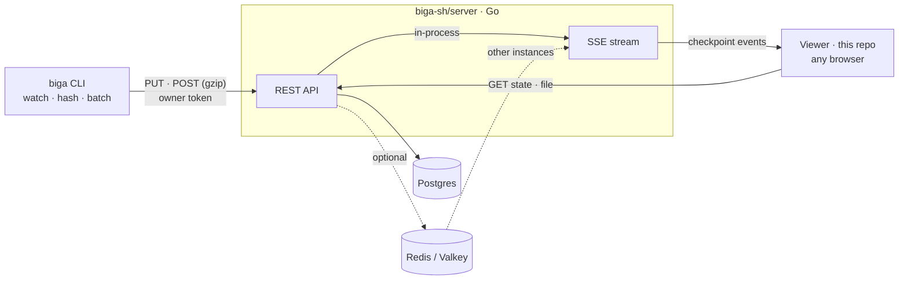

<div align="center">

# biga

**Stream your saves, not your screen.**

The website and viewer behind [biga](https://github.com/biga-sh/cli):<br>
broadcast a folder as a live, read-only link. No accounts, nothing to install.

[](https://github.com/biga-sh/website/actions/workflows/ci.yml)
[](https://github.com/biga-sh/cli/releases/latest)

</div>

This repository is the read-only viewer a link opens, the marketing site and
the documentation. Sessions are stored and streamed by the Go
[API server](https://github.com/biga-sh/server); to run everything together on
your own machine or network, use [biga-sh/docker](https://github.com/biga-sh/docker).

## Run it locally

You need Node 22+, pnpm, and the [API server](https://github.com/biga-sh/server)
on `:8080` (it needs Go and a Postgres database).

```sh
# in a checkout of biga-sh/server
DATABASE_URL=postgres://… go run ./cmd/biga-server

# here
pnpm install
pnpm dev                                       # http://localhost:3000
```

In development `/api/sessions/*` is proxied to `http://localhost:8080`
(`BIGA_SERVER_URL` changes it). Then, in any project, with the
[CLI installed](https://github.com/biga-sh/cli#install):

```sh
biga start
```

The CLI talks to `http://localhost:3000` by default, so the link it prints
opens your local copy.

## How it fits together



The CLI uploads a snapshot, then a checkpoint for every burst of saves. The
server stores them (content-addressed, so a file saved back to an earlier state
costs nothing) and relays each one to the viewers on that session over
server-sent events. Only the CLI that created a session can write to it. The
full tour is in the [architecture docs](apps/web/content/docs/architecture.mdx),
and the endpoints are in the [API reference](apps/web/content/docs/api.mdx).

## Repository

| Path | What it is |
| --- | --- |
| `apps/web` | The Next.js app: landing page, documentation (Fumadocs, in `content/docs`) and the session viewer. |
| `packages/stores` | The viewer's Zustand stores. |
| `packages/types` | Zod schemas and types for the API the viewer reads. |
| `packages/eslint-config`, `packages/typescript-config` | Shared tooling config. |
| `apps/cli` | `@zenshilabs/spire`, the original Node CLI, **deprecated**. Its last release only points people at `biga`, which is now a Go binary. |

## Configuration

| Variable | Description |
| --- | --- |
| `BIGA_SERVER_URL` | Where `/api/sessions/*` is proxied. Defaults to `http://localhost:8080` in development; leave unset in production when a reverse proxy routes it. |
| `NEXT_PUBLIC_BIGA_API_URL` | Have browsers call the API server directly instead (it must list this site in `BIGA_CORS_ORIGINS`). Baked in at build time. |
| `NEXT_PUBLIC_SITE_URL` | Public origin, for absolute metadata URLs. Defaults to `http://localhost:3000`. |
| `BIGA_DEMO_SESSION_ID` | The session the landing page embeds. |

The server's own settings are in its [README](https://github.com/biga-sh/server#configuration).

## Docker

`docker build -t biga-web .` builds the site as a standalone Node server
(`NEXT_PUBLIC_SITE_URL` and `NEXT_PUBLIC_BIGA_API_URL` are build arguments).
[biga-sh/docker](https://github.com/biga-sh/docker) runs it with the API
server, Postgres and Caddy.

## Development

```sh
pnpm dev          # the web app
pnpm build        # build every workspace
pnpm check-types  # type-check
pnpm lint         # lint
```

Two generated pieces are committed, and have scripts to rebuild them:

| Script (in `apps/web`) | Regenerates |
| --- | --- |
| `node scripts/build-showcase.mjs` | The snapshot of the CLI repository the landing page renders in the real viewer (`src/lib/showcase`). Needs the CLI checked out next to this repo. |
| `node scripts/build-brand-assets.mjs` | The downloadable logo files in `public/brand`. |

## License

[MIT](LICENSE)
