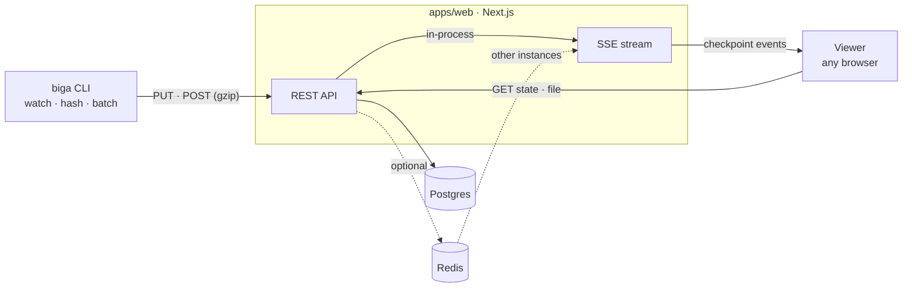

<div align="center">

# biga

**Stream your saves, not your screen.**

The server, viewer and website behind [biga](https://github.com/biga-sh/cli):<br>
broadcast a folder as a live, read-only link. No accounts, nothing to install.

[](https://github.com/biga-sh/website/actions/workflows/ci.yml)
[](https://github.com/biga-sh/cli/releases/latest)

</div>

This repository is everything on the other side of the wire from the
[`biga` CLI](https://github.com/biga-sh/cli): the API that stores sessions and
streams them live, the read-only viewer a link opens, and the marketing site
and documentation.

## Run it locally

You need Node 22+, pnpm, and a Postgres database ([Neon](https://neon.tech)
works out of the box).

```sh
pnpm install
cp apps/web/.env.example apps/web/.env.local   # set DATABASE_URL
pnpm db:push                                   # create the tables
pnpm dev                                       # http://localhost:3000
```

Then, in any project, with the [CLI installed](https://github.com/biga-sh/cli#install):

```sh
biga start
```

The CLI talks to `http://localhost:3000` by default, so the link it prints
opens your local copy.

## How it fits together



The CLI uploads a snapshot, then a checkpoint for every burst of saves. The
server stores them (content-addressed, so a file saved back to an earlier state
costs nothing) and relays each one to the viewers on that session over
server-sent events. Redis is optional and only needed to run more than one
instance. The full tour, with sequence diagrams and the data model, is in the
[architecture docs](apps/web/content/docs/architecture.mdx), and the endpoints
are in the [API reference](apps/web/content/docs/api.mdx).

## Repository

| Path | What it is |
| --- | --- |
| `apps/web` | The Next.js app: landing page, documentation (Fumadocs, in `content/docs`), session viewer and the REST + SSE API. |
| `packages/server` | Session, checkpoint and file logic, and live-event delivery. |
| `packages/db` | Drizzle schema and queries for Postgres. |
| `packages/redis` | The optional Redis bridge: pub/sub, cache and sequence counters. |
| `packages/stores` | The viewer's Zustand stores. |
| `packages/types` | Zod schemas and types shared by the server and the viewer. |
| `packages/eslint-config`, `packages/typescript-config` | Shared tooling config. |
| `apps/cli` | `@zenshilabs/spire`, the original Node CLI, **deprecated**. Its last release only points people at `biga`, which is now a Go binary. |

## Configuration

| Variable | Required | Description |
| --- | --- | --- |
| `DATABASE_URL` | yes | Postgres connection string. |
| `REDIS_URL` | no | A TCP `rediss://` URL. Enables cross-instance live events and a shared cache. |
| `NEXT_PUBLIC_SITE_URL` | no | Public origin, for absolute metadata URLs. Defaults to `http://localhost:3000`. |
| `CRON_SECRET` | for cleanup | Bearer token protecting `/api/cron/cleanup`. |
| `BIGA_RETENTION_DAYS` | no | Days an ended session is kept. Defaults to 30. |
| `BIGA_DEMO_SESSION_ID` | no | A session the cleanup never deletes. |

The size limits, eager-loading thresholds and staleness window are tunable too;
see [self-hosting](apps/web/content/docs/self-hosting.mdx). The `BIGA_` settings
were `SPIRE_` before the rename, and the old spellings are still read.

Live updates hold a connection open per viewer, so deploy on a long-running
Node host. A purely serverless or edge deployment can't fan events out.

## Development

```sh
pnpm dev          # the web app
pnpm build        # build every workspace
pnpm check-types  # type-check
pnpm lint         # lint
```

Two generated pieces are committed, and have scripts to rebuild them:

| Script (in `apps/web`) | Regenerates |
| --- | --- |
| `node scripts/build-showcase.mjs` | The snapshot of the CLI repository the landing page renders in the real viewer (`src/lib/showcase`). Needs the CLI checked out next to this repo. |
| `node scripts/build-brand-assets.mjs` | The downloadable logo files in `public/brand`. |

## License

[MIT](LICENSE)
